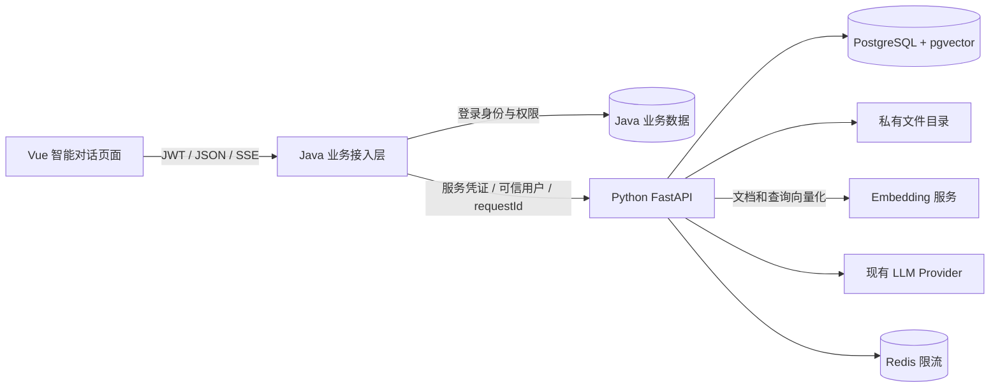
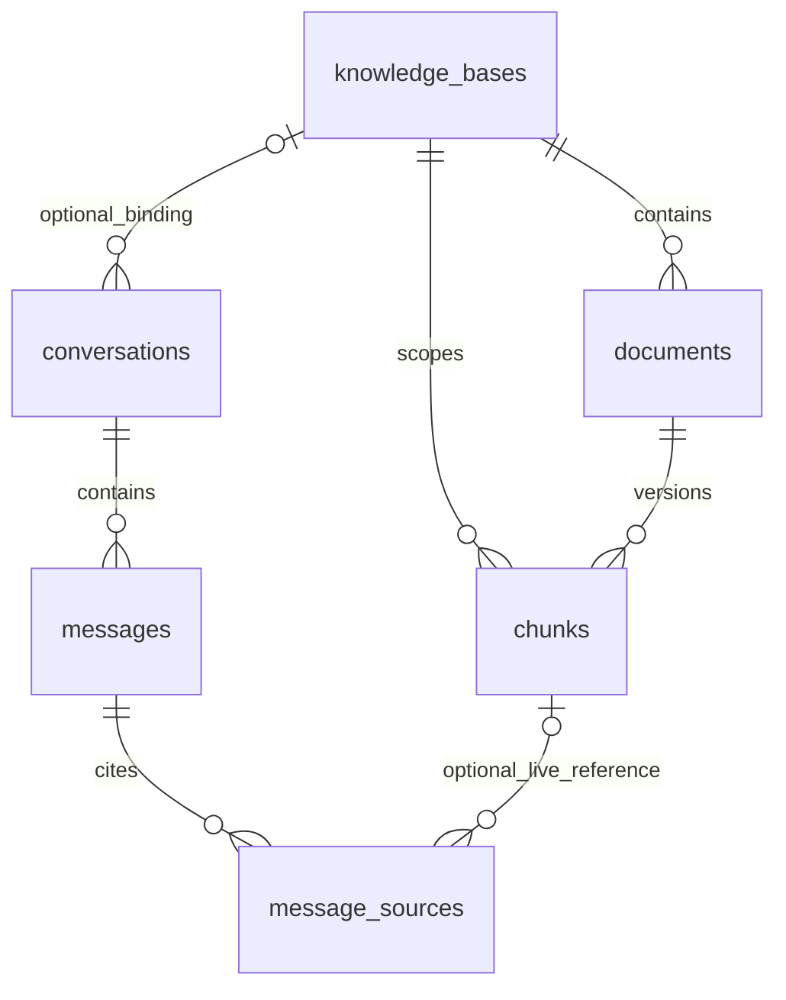
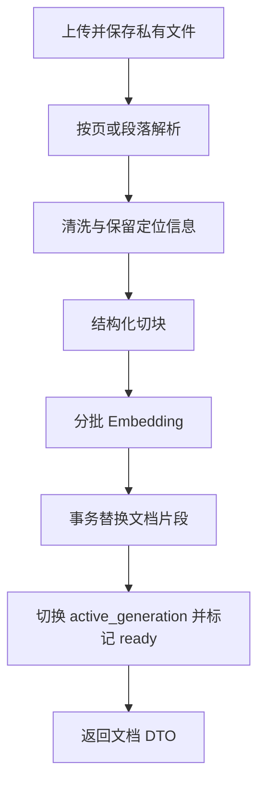

# RAG 模块全新开发方案

日期：2026-10-28

状态：当前实施基线

涉及工程：`ai-chat`、`adminTemplate/java-backend`、`adminTemplate/frontend`

## 1. 目标与首版边界

目标是从零设计业务级 RAG 模块：用户上传文档，系统在请求内同步解析和建立索引，用户按知识库进行多轮对话，回答能回看原始依据，聊天记录可持久化恢复。索引请求失败或中断时由调用方显式重试。

本方案默认：单个业务系统、登录用户私有知识库、一段会话最多绑定一个知识库、一个知识库允许多个文档。普通对话不绑定知识库。身份认证由 Java 业务系统负责，RAG 不创建独立用户/密码体系。

首版支持文本型 PDF、DOCX、UTF-8 TXT、Markdown。扫描 PDF 返回明确提示；`.doc`、OCR、图片理解、语音、网页抓取、组织共享、跨知识库检索暂不进入首版。前端上传白名单必须同步收窄，不能展示未实现的格式。

以下数字均是初始配置或验收目标，需要用真实文档和部署资源校准，不能视为已有性能结论。

## 2. 绿地设计基线

本次按全新业务域实施，不从任何已有知识库 DDL、表名、列名、主键、状态枚举、关系、索引、API 路由或请求/响应 DTO 推导新设计，也不做旧数据导入、双写、兼容适配或旧接口保留。

只复用跨业务域的系统边界：前端经 Java 完成 JWT 和菜单权限校验，再由 Java 安全地调用 Python AI 服务；Python 使用统一的生成模型接入层。知识库、文档、片段、RAG 会话、消息和引用全部由本方案重新定义。

首版复用现有 `DATABASE_URL` 连接的 PostgreSQL 数据库，但所有 RAG 表只放在独立的 `rag` schema，使用全新迁移建表，不与旧表混用。业务用户由 Java 认证，但 RAG 只保存稳定的 `ownerId` 字符串，不依赖 Java 用户表结构或跨库外键。服务间凭证和私有文件根目录为本模块新增配置；生产环境如需最小权限，再为该 schema 单独配置数据库角色。

产品边界假设是单业务系统的用户私有知识库；知识库共享、组织空间、跨租户检索属于独立需求，首版不预留隐式共享规则。

## 3. 架构选择与职责

### 3.1 推荐方案

保留前端 → Java → Python，Python 统一维护 AI 领域数据，PostgreSQL + pgvector 同库保存元数据、片段和向量。



| 层 | 负责 | 数据写入权限 |
| --- | --- | --- |
| 前端 | 知识库、文档、会话界面；上传；SSE 解析；中止请求 | 仅调用 Java |
| Java | JWT、业务权限、请求约束、可信身份、外部 JSON 契约、文件和 SSE 转发 | Java 业务数据；不直接读写 RAG 数据库 |
| Python API | 资源归属校验、同步解析/切块/Embedding、知识库/文档/会话业务、检索编排、模型生成 | 新建 PostgreSQL `rag` schema 与私有文件 |
| 现有 `DATABASE_URL` 对应的 PostgreSQL 数据库 | RAG 元数据、聊天记录、片段和向量的权威存储；表限定在 `rag` schema | Python API 使用现有连接；生产可再收紧 schema 权限 |
| Redis | 速率限制、短期协调；不是聊天记录的权威存储 | Python |

Java 负责接口级业务权限，Python 负责“这个用户能否操作这条知识库/会话记录”。所有权只在 Python 有一份权威记录，不在 Java 再保存一套知识库表。

### 3.2 为什么选这条路线

| 备选 | 优点 | 需要承担的代价 | 结论 |
| --- | --- | --- | --- |
| Python + PostgreSQL + pgvector | 元数据、消息与向量可在同一事务边界内发布 | 需要部署 pgvector 并维护迁移 | 推荐 |
| Python + PostgreSQL + 独立向量服务 | 向量检索可以独立扩展 | 需要处理跨存储一致性和双写恢复 | 首版不采用 |
| Java 管 RAG 元数据、Python 管向量 | Java 可直接承接更多业务数据 | 跨服务双写，AI 领域的索引状态分散 | 本次不采用 |

pgvector 扩展负责 PostgreSQL 中的向量列、距离计算和向量索引，不负责把文本转换成向量。文档切块和用户查询必须先经过同一个 Embedding 模型得到浮点向量，再由 pgvector 存储和检索。首版按独立 Embedding 模型接入；可以通过兼容 OpenAI `/embeddings` 协议的服务调用，也可以另行选择 Python 本地加载模型，但不能把“安装了 pgvector”当成已经具备向量化能力。

首版使用固定的真实 Embedding 模型和维度。建议部署 `bge-m3`，按 1024 维建立索引。生成模型接入 Python AI 服务的统一 Provider 层，首版模型在联调确认后列入白名单。Embedding 与生成是两个模型任务，不能用生成模型名称代替 Embedding 配置。开发前必须验证 Embedding 模型可调用、输出维度、中文检索效果和文档/查询向量的一致性。每个已发布索引版本固定模型版本；模型变化通过重新处理文档发布新版本，绝不混用不同空间的向量。

## 4. 身份、权限与隔离

1. 浏览器只提交业务 JWT；请求体不得接收 `ownerId`、`userId` 或自选的上游地址。
2. Java 解析 JWT，执行业务权限规则，然后只设置 `X-User-Id` 和 `X-Request-Id` 等服务端可信请求头。不复制客户端伪造的同名头。
3. Java → Python 除可信用户头，还必须有独立 `X-Service-Token`，通过环境配置注入，不复用用户 JWT 密钥。远程部署使用 TLS；Python 只在受限服务网络暴露。
4. Python 的新业务路由统一要求服务凭证和可信用户身份。不能继续仅凭任意 `X-User-Id` 就信任调用者。
5. 知识库、文档、会话、消息、原文下载和检索预览全部检查所有权。片段通过关联知识库判断归属。
6. 读消息同时校验会话归属；发送消息同时校验会话与知识库绑定关系。查询不能只按 `conversation_id` 或 `document_id` 单条件取数据。
7. 首版资源仅属于创建者。Java 的管理员角色不自动获得查看所有私有内容的能力；共享与管理员代管将来需要明确授权模型。
8. 不存在和无权访问的资源对外使用同一种“资源不可用”业务结果，避免枚举他人的 ID。

Java 建议采用 `ai:read`、`ai:chat`、`knowledge:read`、`knowledge:write` 权限名，实施时同步菜单权限数据。权限项尚未创建时，不能只加注解就宣布权限已接通。

## 5. 表设计

### 5.1 通用约定

- 复用现有 `DATABASE_URL` 对应的 PostgreSQL 数据库，从空状态初始化 `rag` schema；RAG 业务表不映射或共用其他业务表。
- 主键使用 Python 生成的 UUID，对外一律序列化为字符串。
- 所有权字段使用 `VARCHAR(64)` 的 `owner_id`，保存 Java 已认证用户的稳定 ID 字符串；不对 Java 用户表建外键。
- 时间使用 `TIMESTAMPTZ`，应用传入 UTC 时间，接口输出 ISO 8601 UTC。
- PostgreSQL 列名 `snake_case`；新 Java 和 Python RAG 接口 JSON 均使用 `camelCase`，Pydantic 使用 alias 映射，不依赖手工递归改 key。
- 状态使用受 CHECK 约束的字符串；状态字段不是业务错误码，业务错误码仍为独立数字。
- 新表使用版本化迁移，建议 Alembic；不依赖 `create_all()` 做生产升级。

首版共 6 张表：



### 5.2 `knowledge_bases`：知识库

| 字段 | 类型与约束 | 说明 |
| --- | --- | --- |
| id | UUID PK | 知识库 ID |
| owner_id | VARCHAR(64) NOT NULL | 创建用户 ID，强制隔离条件 |
| name | VARCHAR(100) NOT NULL | 去除首尾空白；允许同名，避免无必要唯一限制 |
| description | VARCHAR(1000) NULL | 简介 |
| status | VARCHAR(20) NOT NULL | `active / disabled / deleted` |
| embedding_model | VARCHAR(150) NOT NULL | 创建时记录模型版本，首版不允许在线修改 |
| embedding_dimension | SMALLINT NOT NULL CHECK (=1024) | 与片段向量列一致 |
| chunk_size | INTEGER NOT NULL | 首版默认 600 字符，建议允许范围 200～1500 |
| chunk_overlap | INTEGER NOT NULL | 默认 100 字符，必须小于 chunk_size |
| created_at / updated_at | TIMESTAMPTZ NOT NULL | 创建与更新时间 |
| deleted_at | TIMESTAMPTZ NULL | 逻辑删除时间 |

索引：`(owner_id, status, updated_at DESC, id DESC)`。文档数和可检索文档数使用聚合查询，不首版维护易失真的计数缓存列。

`PATCH` 首版只开放名称、简介、启用状态。切块或 Embedding 配置变更属于重新建立索引的操作，不能改一个字段后继续用旧向量。

### 5.3 `documents`：文档与当前生效版本

| 字段 | 类型与约束 | 说明 |
| --- | --- | --- |
| id | UUID PK | 文档 ID |
| knowledge_base_id | UUID FK NOT NULL | 所属知识库 |
| created_by | VARCHAR(64) NOT NULL | 上传用户 ID，用于审计；权限仍由知识库决定 |
| file_name | VARCHAR(255) NOT NULL | 原始展示名，不作为磁盘路径 |
| storage_key | VARCHAR(500) NOT NULL | 服务生成的私有存储 key，不返回磁盘绝对路径 |
| file_hash | CHAR(64) NOT NULL | 文件 SHA-256 |
| mime_type | VARCHAR(100) NOT NULL | 检测后的类型 |
| file_size | BIGINT NOT NULL CHECK (>0) | 文件字节数，接口额外限制最多 20 MiB |
| status | VARCHAR(20) NOT NULL | `pending / processing / ready / failed / deleted` |
| active_generation | INTEGER NOT NULL DEFAULT 0 | 当前可检索索引版本；0 表示还没有索引 |
| latest_generation | INTEGER NOT NULL DEFAULT 0 | 最近一次同步构建分配的版本号，单调递增 |
| chunk_count / page_count | INTEGER NOT NULL / INTEGER NULL | 当前生效版本统计 |
| parser_version / splitter_version | VARCHAR(50) NULL | 当前生效解析、切块配置版本 |
| error_code / error_message | INTEGER NULL / VARCHAR(500) NULL | 处理失败的安全错误摘要 |
| created_at / updated_at / deleted_at | TIMESTAMPTZ | 生命周期 |
| purged_at | TIMESTAMPTZ NULL | 逻辑删除后的物理清理完成时间 |

约束：`0 <= active_generation <= latest_generation`；`UNIQUE(id, knowledge_base_id)` 供片段复合外键使用。

索引：`(knowledge_base_id, status, created_at DESC, id DESC)`；未删除文档的 `(knowledge_base_id, file_hash)` 唯一，重复上传返回原文档与 `deduplicated=true`。

同一文件在不同知识库分别建立文档和索引，不能跨用户去重后暴露其他用户的信息。

### 5.4 `chunks`：片段、定位信息与向量

| 字段 | 类型与约束 | 说明 |
| --- | --- | --- |
| id | UUID PK | 片段 ID |
| knowledge_base_id | UUID FK NOT NULL | 检索必须携带的范围 |
| document_id / generation | UUID / INTEGER NOT NULL | 文档及索引版本 |
| chunk_index | INTEGER NOT NULL CHECK (>=0) | 同一版本内的分段顺序 |
| content | TEXT NOT NULL | 可直接用于构建上下文的文本 |
| content_hash | CHAR(64) NOT NULL | 定位重复块和排查问题，不作为全局唯一键 |
| token_count | INTEGER NOT NULL CHECK (>0) | 经已选模型可用 tokenizer 或保守估算得到的预算数 |
| page_from / page_to | INTEGER NULL | PDF 的页码，从 1 开始 |
| section_title | VARCHAR(500) NULL | Markdown/DOCX 标题路径 |
| metadata | JSONB NOT NULL DEFAULT '{}' | 其余受控定位字段，不放文件绝对路径 |
| embedding | VECTOR(1024) NOT NULL | 真实模型生成的向量 |
| created_at | TIMESTAMPTZ NOT NULL | 创建时间 |

约束：`UNIQUE(document_id, generation, chunk_index)`；复合外键 `(document_id, knowledge_base_id)` 指向 `documents(id, knowledge_base_id)`，避免错误地把其他知识库的文档挂进来。

索引：`(knowledge_base_id, document_id, generation)`。首版优先使用权限过滤后的精确向量检索；有性能证据后增加 HNSW，不一开始就引入 ANN 的过滤召回问题。

### 5.5 `conversations`：统一普通/RAG 会话

| 字段 | 类型与约束 | 说明 |
| --- | --- | --- |
| id | UUID PK | 会话 ID |
| owner_id | VARCHAR(64) NOT NULL | 会话所有者用户 ID |
| knowledge_base_id | UUID FK NULL | NULL 为普通聊天；非空为绑定知识库聊天 |
| title | VARCHAR(200) NOT NULL | 默认“新会话”，首条问题截断生成标题，不额外调用模型 |
| model | VARCHAR(100) NOT NULL | 从后端支持白名单选择的生成模型 |
| status | VARCHAR(20) NOT NULL | `active / archived / deleted` |
| next_message_seq | BIGINT NOT NULL DEFAULT 1 | 在会话行短事务锁中分配消息顺序号 |
| created_at / updated_at / deleted_at | TIMESTAMPTZ | 生命周期 |

索引：`(owner_id, status, updated_at DESC, id DESC)`，以及 `(owner_id, knowledge_base_id, updated_at DESC, id DESC)`。

创建绑定会话时校验知识库属于当前用户。已有会话的知识库绑定不可直接修改，前端切换知识库应切换列表或新建会话，避免同一历史混进另一知识库的上下文。

### 5.6 `messages`：消息与一次生成的状态

| 字段 | 类型与约束 | 说明 |
| --- | --- | --- |
| id | UUID PK | 消息 ID |
| conversation_id | UUID FK NOT NULL | 所属会话 |
| seq | BIGINT NOT NULL | 会话内稳定排序，不能仅依赖毫秒时间戳 |
| client_request_id | UUID NOT NULL | 前端生成的一次发送请求 ID；同一轮的用户/助手记录共享 |
| request_hash | CHAR(64) NOT NULL | 内容、模型等生成参数的稳定摘要，防止复用请求 ID 却换内容 |
| role | VARCHAR(20) NOT NULL | 首版 `user / assistant`，API 也统一小写 |
| content | TEXT NOT NULL DEFAULT '' | 完整或已生成的部分内容 |
| status | VARCHAR(20) NOT NULL | `completed / generating / failed / cancelled` |
| model | VARCHAR(100) NULL | 助手实际使用模型 |
| retrieval_query | TEXT NULL | RAG 实际检索问题；排查多轮检索，按聊天记录保护 |
| prompt_version | VARCHAR(50) NULL | 提示词版本 |
| prompt_tokens / completion_tokens / total_tokens | INTEGER NULL | 缺少供应商用量时为 NULL，不能把 0 当真实用量 |
| finish_reason | VARCHAR(50) NULL | 模型停止原因或本地终止原因 |
| error_code / error_message | INTEGER NULL / VARCHAR(500) NULL | 失败详情摘要 |
| request_id | VARCHAR(128) NOT NULL | 跨 Java/Python 的请求追踪号 |
| created_at / updated_at / completed_at | TIMESTAMPTZ | 生命周期 |

约束：`UNIQUE(conversation_id, seq)`；`UNIQUE(conversation_id, client_request_id, role)`；同一会话最多一条 `role='assistant' AND status='generating'` 的部分唯一索引。

同一 `clientRequestId` 重复到达时，不再写入消息或重新计费生成。已在生成返回“本轮处理中”；已完成返回“本轮已处理”和已有消息 ID，前端刷新历史。哈希不同则返回“请求 ID 与内容冲突”。首版不实现 SSE 事件重放。

### 5.7 `message_sources`：回答引用快照

| 字段 | 类型与约束 | 说明 |
| --- | --- | --- |
| id | UUID PK | 引用 ID |
| message_id | UUID FK NOT NULL | 对应助手消息 |
| citation_index | SMALLINT NOT NULL CHECK (>0) | 对应回答中的 `[1]`、`[2]` |
| chunk_id | UUID FK NULL | 活跃片段引用；物理回收片段时 SET NULL |
| document_id_snapshot / generation_snapshot | UUID / INTEGER NOT NULL | 引用时的文档与版本，不级联删除 |
| document_name / page_from / page_to / section_title | VARCHAR / INTEGER / VARCHAR | 引用定位快照 |
| content_excerpt | TEXT NOT NULL | 实际提供给模型的裁剪片段快照，最多 2000 字符 |
| vector_similarity | DOUBLE PRECISION NULL | 余弦相似度，不包装成“答案准确率” |
| created_at | TIMESTAMPTZ NOT NULL | 创建时间 |

约束：`UNIQUE(message_id, citation_index)`；按 `message_id` 查询。历史引用不得只保存 chunk ID，否则重新索引后无法解释过去的回答。

文档删除会使原文入口不可用，但历史回答和引用快照按会话保留。界面需说明“删除文档不会自动删除历史聊天”。若有彻底擦除需求，需要删除相关会话/引用并执行物理清理，不能把逻辑删除称为内容已经销毁。

### 5.9 必须落实的数据库约束示例

下面只展示关键约束；完整迁移在实施阶段编写，不在方案阶段执行 DDL：

```sql
CREATE UNIQUE INDEX uq_document_hash_live
ON documents (knowledge_base_id, file_hash)
WHERE status <> 'deleted';

CREATE UNIQUE INDEX uq_conversation_active_generation
ON messages (conversation_id)
WHERE role = 'assistant' AND status = 'generating';
```

## 6. 文档处理流程

### 6.1 上传和同步索引

1. Java 验证 JWT、权限和体积限制，以 multipart 流转发给 Python；两个服务不共享客户端传入的本地路径。
2. Python 再检查资源归属、文件类型、大小和内容。首版单文件最多 20 MiB；同时设置解析后的文本长度、PDF 页数和 DOCX 解压后体积限制。
3. 文件流写入私有目录的临时文件，同时计算 SHA-256。根目录由配置提供，生成随机 storage key；原始文件名仅展示。
4. 查询知识库内哈希；重复则清理本次临时文件并返回已有文档。并发重复依赖数据库唯一约束兜底。
5. 原子重命名临时文件到最终位置，创建文档并在同一请求内依次完成解析、切块和 Embedding。
6. 片段与文档 `ready` 状态在同一事务提交。上传接口成功时返回 HTTP 200 和完整文档 DTO；重复文件返回已有文档，不自动重建。

原文件不放 Java `public/uploads` 或可匿名访问的目录。原文通过鉴权下载接口流式读取，或以后使用短有效期的授权对象存储 URL。

### 6.2 失败与重试

解析、切块和 Embedding 都在上传或重建请求内执行，不启动 worker，也不创建任务表。运行 FastAPI 服务即可完成文档索引。

上传失败会回滚数据库并删除本次保存的文件；重建失败会回滚事务，保留原有可检索片段。请求超时、中断或 Embedding 失败后不会后台继续，调用方需要重新发起上传或重建。完整错误栈只在内部日志，接口返回安全摘要。

### 6.3 解析、切块、向量化与原子发布



PDF 首版用 `pypdf` 按页提取；DOCX 用 `python-docx` 提取段落与表格，保留标题路径；TXT/Markdown 规范换行但保留段落、列表、编号、数值和表格关系。扫描件不生成空向量，要返回“需要 OCR，目前不支持”。

沿用 `RecursiveCharacterTextSplitter`，先按标题/页/段落分割，再处理过长段落，默认 600 字符、重叠 100 字符。尽量避免跨页切块以保留可靠页码。字符数不是 token 数；构建提示词时仍需按 token 预算裁剪。

Embedding 建议每批最多 32 块，同时限制批次总 token。文档与查询使用相同模型、预处理和供应商要求的 query/document 输入约定。必须检查向量数量、维度、有限数值及非零向量，异常不能带入索引。

首次处理在请求事务中完成，成功提交后文档为 `ready`。重建时文档在提交前继续使用原有效索引，新片段使用新 generation，检索只读取 `active_generation`。

发布时替换目标文档片段，并原子更新 active generation、片段统计和文档状态。事务失败会回滚，旧索引保持可用。

问答侧在查询向量已准备好之后，用一个短事务对候选文档取共享锁，复核其状态和生效版本，读取片段并写入 message_sources 快照，然后提交。发布与清理使用冲突的文档行锁，保证引用快照写入前片段不会被回收；这些事务内不调用 Embedding 或 LLM。旧版本和失败版本延迟清理，不用删除整个目录的方式实现重建。

### 6.4 删除与重建

- 删除文档：在事务中标记 deleted 并从检索排除，再删除片段和私有文件。
- 删除知识库：标记 deleted 并批量标记其文档；绑定会话保留历史，但禁止继续生成，不偷偷退回普通聊天。
- 文档重建：锁定文档，递增 latest_generation，在当前请求内重新解析、向量化并原子替换片段，成功后返回更新后的文档。
- Embedding 模型变化：首版不在线混合模型；新建知识库并重新导入原文件，验证后切换使用。不能只修改模型名或 padding 旧向量。

## 7. 检索与多轮问答

### 7.1 一轮请求的处理顺序

1. 校验服务身份、用户、内容长度、模型白名单、会话及知识库归属；检查并发生成与幂等请求 ID。
2. 短事务创建 user 和 assistant 消息，给两条记录分配连续 seq，assistant 状态为 generating，然后释放事务。
3. 读取最近已成功完成的历史轮次，排除 failed/cancelled/generating 的半轮内容。普通聊天也使用同一套历史编排。
4. RAG 模式构造检索问题，生成 query embedding，在所属知识库的生效片段中检索。
5. 进行相关性筛选、重复片段去除和上下文预算裁剪，生成本轮引用编号；保存实际使用的引用快照。
6. 组装系统规则、有限历史、检索材料和当前问题，调用现有 `BaseLLMProvider.stream_chat()`。
7. 结束时一次持久化最终内容、状态、用量和 finish reason；失败或取消时保存当前已有的部分内容。
8. 只有数据库提交成功才发送 done。不能先宣告完成、之后保存失败。

### 7.2 检索必须有的条件

所有 SQL 参数化。下面是逻辑示例，生产实现还需要状态、输入和向量校验：

```sql
SELECT c.id, c.document_id, c.content, c.page_from, c.page_to,
       c.section_title, d.file_name,
       1 - (c.embedding <=> :query_embedding) AS vector_similarity
FROM chunks c
JOIN documents d
  ON d.id = c.document_id AND d.knowledge_base_id = c.knowledge_base_id
JOIN knowledge_bases kb ON kb.id = c.knowledge_base_id
WHERE kb.id = :knowledge_base_id
  AND kb.owner_id = :current_user_id
  AND kb.status = 'active'
  AND d.status = 'ready'
  AND c.generation = d.active_generation
ORDER BY c.embedding <=> :query_embedding, c.id
LIMIT :candidate_k;
```

这里的 named parameters 是示意，实际绑定遵守 SQLAlchemy/pgvector 的类型适配，不能把向量或用户条件拼进 SQL。

初始取候选 20 块，去重后保留至多 5 块。相似度阈值必须用所选模型和真实问题集校准，不能机械使用一个通用 0.7。首版提供检索预览用于调参。

当精确检索在代表性数据上达到延迟瓶颈后，再增加 `vector_cosine_ops` HNSW。届时专项验证权限过滤后的召回，选择 pgvector 支持的迭代扫描或过采样，并保留不足时的过滤精确检索回退，不能先全库取 topK 再按用户过滤。

### 7.3 多轮问题与上下文预算

首版从最近至多 6 个成功轮次中，使用生成模型把有历史依赖的问题改写成独立检索问题，例如“那试用期呢”结合上文改成“员工试用期的请假规定”。已有上下文时默认改写，首轮省略；改写失败回退原问题并记录降级，不中断正常可回答请求。

改写只用于检索，用户原始内容单独保存且不被替换。改写模型不具有文件或工具权限。历史中的事实不能替代当前知识库依据。

初始预算：历史最多 2000 token、检索材料最多 4000 token、问题最多 1000 token、回答最多 1500 token；额外预留系统提示和安全余量。实际总额必须小于配置模型的窗口，禁止把整个会话和所有候选块直接塞入模型。

没有可用依据时返回“根据当前知识库无法确认”，标记 `answerMode=insufficient_evidence`，不把模型常识伪装成文档结论。普通聊天 `answerMode=chat`；有材料的 RAG 回答为 `grounded`。

检索材料属于不可信内容，放在独立资料段中并明确只作为证据；文档中的“忽略之前指令”等不得提升为系统指令。首版 RAG 不开放任意工具执行。

### 7.4 引用规则

先确定本轮上下文，再分配 `[1]...[N]`，模型只能引用这些编号。流中发送 sources，历史消息也返回同样的引用 DTO。

引用卡片包括文档 ID、文件名、页码/章节、片段摘要和是否仍可打开原文。引用快照表示“这些材料实际交给了模型”，不表示每一句生成内容已经被自动证实。流式输出无法完整后审再展示，验收必须包含人工核对引用与结论。

首版不做全局答案缓存。之后若增加，至少需要用户/权限范围、知识库、有效索引版本、对话上下文摘要、生成模型和 prompt 版本共同构成 key。

## 8. 全新对外接口设计：前端只访问 Java

### 8.1 公共约定

- 前缀 `/v1`；认证仍由 Headers 的 `Authorization: Bearer <token>` 提供。
- JSON 返回沿用当前 Java `Result<T>`，不增加自动响应包装器。
- 列表返回 `data.items` 与 `data.nextCursor`；默认 limit=20，最大 100，按稳定排序字段与 ID 游标分页。
- 请求与响应 camelCase；UUID 为字符串；页面统一识别小写消息 role。
- 查询/更新 HTTP 200，创建普通资源 201，上传/重建同步成功为 200，删除 204 空体。
- 业务失败按项目约定使用 HTTP 200 + 独立数字业务码；协议错误保留真实 HTTP；系统与外部服务故障保留 500/502。
- SSE 开始前返回的 JSON 错误仍遵守上项；开始后只发送 error 事件。

### 8.2 知识库与文档

| 方法 | Java 路径 | 关键输入 | 返回 data / 行为 | 优先级 |
| --- | --- | --- | --- | --- |
| POST | `/v1/ai/knowledge-bases` | name、description | 知识库 DTO | P0 |
| GET | `/v1/ai/knowledge-bases` | cursor、limit | items、nextCursor；每项有 documentCount、readyDocumentCount | P0 |
| GET | `/v1/ai/knowledge-bases/{knowledgeBaseId}` | 路径 ID | 知识库详情 | P0 |
| PATCH | `/v1/ai/knowledge-bases/{knowledgeBaseId}` | name、description、status | 更新后的知识库 | P1 |
| DELETE | `/v1/ai/knowledge-bases/{knowledgeBaseId}` | 路径 ID | 逻辑删除成功后 204 | P1 |
| POST | `/v1/ai/knowledge-bases/{knowledgeBaseId}/documents` | multipart 的 file | HTTP 200：索引完成后的文档 DTO；重复文件返回已有文档 | P0 |
| GET | `/v1/ai/knowledge-bases/{knowledgeBaseId}/documents` | cursor、limit | 文档列表，含生效状态 | P0 |
| GET | `/v1/ai/knowledge-bases/{knowledgeBaseId}/documents/{documentId}` | 两级路径 ID | 文档详情 | P0 |
| GET | `/v1/ai/knowledge-bases/{knowledgeBaseId}/documents/{documentId}/content` | 两级路径 ID | 鉴权原文下载；附件流，不包 Result | P0 |
| POST | `/v1/ai/knowledge-bases/{knowledgeBaseId}/documents/{documentId}/reindex` | 无需再传文件 | HTTP 200：重建完成后的文档 DTO | P0 |
| DELETE | `/v1/ai/knowledge-bases/{knowledgeBaseId}/documents/{documentId}` | 两级路径 ID | 逻辑删除成功后 204，后台物理清理 | P1 |
| POST | `/v1/ai/knowledge-bases/{knowledgeBaseId}/retrieval-preview` | query、topK（1～20，默认 5） | 命中片段、定位、相似度、耗时；不调用生成模型 | P0 |

P0 是首次完整接入的必要范围，P1 是上线前的管理完善。文档原文下载不使用公开文件模块；支持附件整文件下载即可，首版不额外实现 PDF 在线编辑或预览器。

### 8.3 统一会话接口

| 方法 | Java 路径 | 关键输入 | 返回 data / 行为 |
| --- | --- | --- | --- |
| POST | `/v1/ai/conversations` | title 可选、knowledgeBaseId 可空、model 可选 | 会话 DTO；无知识库就是普通聊天 |
| GET | `/v1/ai/conversations` | mode=`all/chat/knowledge`、knowledgeBaseId 可选、cursor、limit | 当前用户会话列表；knowledgeBaseId 可指定知识库过滤 |
| GET | `/v1/ai/conversations/{id}` | 会话 ID | 会话详情与绑定知识库概要 |
| PATCH | `/v1/ai/conversations/{id}` | title 或 status | 改名/归档；不修改知识库绑定 |
| DELETE | `/v1/ai/conversations/{id}` | 会话 ID | 逻辑删除后 204；活动生成同时取消 |
| GET | `/v1/ai/conversations/{id}/messages` | beforeSeq 可选、limit | data.items、nextBeforeSeq；取最近一页，页内按 seq 升序 |
| POST | `/v1/ai/conversations/{id}/messages/stream` | clientRequestId、content | 按会话绑定自动选择普通/RAG；SSE |

会话列表每项至少包含 `id/title/knowledgeBaseId/model/latestMessage/updatedAt`；历史消息包含 `id/seq/role/content/status/sources/createdAt`。

发送请求不接受客户端提交的历史消息或自由切换知识库，历史与权限由服务器恢复。示例：

```json
{
  "clientRequestId": "4caf96d0-6879-42f5-a447-942b3e1c4a0b",
  "content": "员工试用期可以请假吗？"
}
```

RAG 对外只发布本节定义的新接口，不保留旧路由别名或旧请求 DTO。普通聊天与知识库聊天统一通过会话流式接口进入，避免新前端仍需维护两套聊天协议。

### 8.4 JSON 示例

创建会话时 `knowledgeBaseId=null` 表示普通对话：

```json
{
  "title": "员工制度咨询",
  "knowledgeBaseId": "28927c14-4dcf-49db-9a91-d81629cb2392",
  "model": "deepseek-chat"
}
```

分页响应示例，requestId 与本次 Java 请求相同：

```json
{
  "code": 0,
  "data": {
    "items": [
      {
        "id": "28927c14-4dcf-49db-9a91-d81629cb2392",
        "name": "员工手册",
        "status": "active",
        "documentCount": 2,
        "readyDocumentCount": 1
      }
    ],
    "nextCursor": null
  },
  "message": "操作成功",
  "success": true,
  "requestId": "rag-request-001",
  "timestamp": "2026-10-28T09:00:00Z",
  "details": null
}
```

### 8.5 业务码草案

以下为新增预留范围，实施前先检查 `BusinessError/SystemError`，冲突时重新分配。枚举名称可以是英文，响应 code 必须是数字。

| 数字码 | 含义 | HTTP / 流中行为 |
| --- | --- | --- |
| 160101 | 知识库不存在、无权访问或已删除 | 业务 HTTP 200 |
| 160102 | 知识库已禁用 | 业务 HTTP 200 |
| 160103 | 知识库没有可用文档 | 业务 HTTP 200；不是依赖故障 |
| 160111 | 文档不存在或无权访问 | 业务 HTTP 200 |
| 160112 | 文件格式不支持、不可提取或超出处理限制 | 业务 HTTP 200，details 给出安全原因 |
| 160121 | 会话不存在或无权访问 | 业务 HTTP 200 |
| 160122 | 会话绑定资源不允许继续问答 | 业务 HTTP 200 |
| 160123 | 同一会话已有生成中的请求 | 业务 HTTP 200 |
| 160124 | 相同发送请求已经处理 | 业务 HTTP 200，details 返回已有消息 ID |
| 160125 | 请求 ID 与内容冲突 | 业务 HTTP 200 |
| 160126 | AI 请求频率或资源配额超过限制 | 业务 HTTP 200，可附 Retry-After |
| 160501 | Embedding 服务失败 | 外部 HTTP 502；已开流时 error |
| 160502 | 生成模型失败 | 外部 HTTP 502；已开流时 error |
| 160503 | 文档处理内部故障 | 外部 HTTP 500；上传或重建请求失败 |
| 160001 / 500000 | Java 无法访问 Python / 未预期内部故障 | 沿用系统错误规则；已开流时 error |

“检索没有足够证据”是一次正常、保守的回答结果，不使用服务器错误码掩盖检索质量问题。

## 9. Java 与 Python 内部接口

Python 内部接口是仅服务间可访问的新契约，前缀为 `/api/v1/rag`。知识库资源使用 `/api/v1/rag/knowledge-bases`，会话使用 `/api/v1/rag/conversations`。Java 外部路由不要求与内部路由逐字相同。

内部请求头固定为：

```http
X-Service-Token: <服务间凭证，由配置提供>
X-User-Id: <Java 验证后的用户 ID>
X-Request-Id: <沿用入口请求 ID>
```

所有 DTO 从空白契约定义，字段使用 camelCase。Python JSON 响应使用明确的 `{code, data, message}` 结构；code 为 0 表示成功，业务失败使用与 Java 对外契约对应的数字码。业务校验失败不透传 FastAPI 默认 422；协议错误保留 400/404/405/415，服务故障保留 500/502。Python 的服务凭证缺失/无效使用内部 HTTP 401/403，Java 将其视为服务间配置故障，对外返回 502，而不是提示用户重新登录。

Java 必须显式检查内部 code：成功 data 转成 DTO，业务 code 转成 BizException，服务故障转成 AppException。Java 对浏览器使用平台统一的 `Result<T>`；Python 内部响应不会直接透传到浏览器。

Java 的 Service 使用有类型的请求/响应 DTO；外部调用不包数据库长事务。全部 `/v1/ai/**` 路由默认受保护，并按本方案定义的权限点检查。

Python 追踪中间件统一接受并验证入口 X-Request-Id，映射到内部日志 trace；不再用用户 ID 拼接新的请求 ID。模型供应商自己的 request ID 单独记录，不覆盖业务请求号。

## 10. SSE 协议与生成状态

### 10.1 统一事件

新会话接口采用命名事件和 JSON data；不再混用裸字符串、`type` 字段和 `[DONE]`。

```text
event: start
data: {"requestId":"rag-request-001","conversationId":"conversation-uuid","userMessageId":"user-message-uuid","assistantMessageId":"assistant-message-uuid","mode":"rag"}

event: sources
data: {"assistantMessageId":"assistant-message-uuid","items":[{"index":1,"documentId":"document-uuid","documentName":"员工手册.pdf","pageFrom":3,"pageTo":3,"sectionTitle":"试用期制度","excerpt":"……","available":true}]}

event: message
data: {"assistantMessageId":"assistant-message-uuid","content":"根据员工手册[1]，"}

event: done
data: {"assistantMessageId":"assistant-message-uuid","status":"completed","answerMode":"grounded","finishReason":"stop","usage":{"promptTokens":800,"completionTokens":120,"totalTokens":920}}
```

失败终态示例：

```text
event: error
data: {"assistantMessageId":"assistant-message-uuid","code":160502,"message":"模型服务暂时不可用","retryable":true,"requestId":"rag-request-001"}
```

start 表示两条消息已经创建；sources 在构建完实际上下文后发送，普通聊天或无证据时可为空数组；message 是增量文本。done/error 是互斥终态，发送后结束流。HTTP 200 不能单独证明生成成功。

Java 应在预校验失败时保留 JSON 错误；只有确认上游 SSE 后才按流转发。前置业务失败必须保留其数字业务码，不能改写成不明原因的 AI 服务异常。

### 10.2 中断、超时与崩溃

- Python 在内存中积累增量内容，正常结束后一次写入最终回答；不逐 token 写数据库。
- 模型等待期间约每 15 秒发送一次 SSE 注释心跳 `: ping`，前端忽略。心跳不代表延长整次问答的总超时。
- 前端通过 AbortController 停止读取；Java 检测写出失败后关闭 Python 连接；Python 捕获取消、关闭上游生成器，保存已产生部分并标记 cancelled。
- 网络断开只保证尽力停止与持久化；进程突然崩溃可能留下 generating 记录，首版不增加后台恢复器。
- 发生生成错误保留部分回答并标记 failed，不写 completed，不继续发 done。
- 首版不实现断线自动继续生成。前端重新拉历史确认实际状态，用户重试使用新的 clientRequestId；同一 ID 不触发第二次生成。

Java/Python/代理的读取空闲超时必须大于心跳周期；整次生成建议起始上限 180 秒，并与当前 Java 异步 5 分钟上限协调。所有上限需要实际压测后确认。

## 11. 代码组织与模块边界

Python 本模块采用 Router → Service → Repository 结构，使用 SQLAlchemy AsyncSession 与 Alembic 管理现有数据库中的独立 `rag` schema。不为本次增加插件系统、通用工作流引擎或第二套 ORM。

```text
app/
  api/v1/rag.py                   # 知识库、文档与同步索引
  api/v1/rag_retrieval.py         # 检索预览
  api/v1/rag_conversations.py     # 统一会话接口
  schemas/rag_internal.py         # camelCase API DTO
  models/rag.py                   # 本方案新建的 6 张表
  repositories/rag_repository.py
  services/rag_management_service.py   # 上传、同步索引和资源查询
  services/rag_retrieval_service.py    # 精确向量检索
  services/rag_conversation_service.py # 检索与生成编排
  rag/documents.py                # 解析与定位
  rag/splitters.py                # 结构化切块
  rag/embeddings.py               # 固定模型的真实 Embedding 接入
  langchain_rag/retriever.py      # 按用户/库/生效版本检索
  langchain_rag/prompts.py        # 受版本管理的 RAG prompt
  llm/                           # 复用 Python 服务的模型调用边界
migrations/                      # 从空数据库建立全新 schema
```

文件划分是职责边界，不要求一次创建所有文件；实现时优先合并体量小且职责相同的逻辑。Embedding 先使用一个有配置的实现；需要第二家供应商时再增加工厂。若使用 LangChain `Embeddings` 接口，检索与文档处理共用同一模型配置，不另起平行向量空间。

Java 在 AI 模块下新增 Controller、Service、DTO 与 Python 客户端适配；只复用平台级 JWT、权限校验和 `Result<T>` 响应契约，不添加 RAG PostgreSQL Mapper 或 JPA。

依赖只覆盖模块需要的能力：`pgvector` 类型适配、`alembic` 迁移、`pypdf`、`python-docx`。Embedding HTTP 使用 Python 标准已有的异步 HTTP 客户端能力。部署需 PostgreSQL vector 扩展和可用 Embedding 服务。

首版只将完成过连通与契约验证的生成模型放入服务端白名单；不能只因配置中写了模型名就认定模型可用。流式适配需处理空 choices 的 usage 汇总帧、供应商终止原因和缺失用量，避免生成结束时丢失状态。

## 12. 前端新契约

前端按本方案的新路由和 DTO 开发，不继续请求其他路径，也不在浏览器直连 Python。

| 页面行为 | 新契约 |
| --- | --- |
| 普通对话与知识库对话 | `/v1/ai/conversations`，`knowledgeBaseId=null` 表示普通会话 |
| 知识库管理 | `/v1/ai/knowledge-bases` |
| 文档上传与状态 | 上传请求等待索引完成；成功响应中的文档状态为 `ready` |
| 历史消息 | `/v1/ai/conversations/{id}/messages`，使用游标分页 |
| 发送消息 | `/v1/ai/conversations/{id}/messages/stream`，提交 `content` 与 `clientRequestId` |
| 消息角色 | 固定小写 `user/assistant` |
| 流式内容 | 按事件名解析；仅 `message.content` 追加文本，`sources` 更新引用 |
| 请求结果 | JSON 判断 `success/code`；SSE 收到 `done` 或 `error` 才算终态 |

SSE 解析器必须处理网络块拆帧、UTF-8 跨块、CRLF、多行 data、注释心跳与最后残帧。请求开始先检查响应 Content-Type，JSON 错误走常规错误展示；onError 等回调缺失时也不能抛出第二个异常。

界面至少增加文档状态、失败原因、重试入口、引用卡片和停止生成。新建会话成功后按返回 ID 选中，不依赖“列表第一项就是刚建的会话”。

新前后端契约一次定稿并同步更新 Apifox；部署按同一发布窗口上线 Java、Python 与前端，不提供旧路径兼容适配器。

## 13. 配置、部署与可观测性

| 配置组 | 首版建议 |
| --- | --- |
| 数据库 | 复用现有 `DATABASE_URL`，初始化独立 `rag` schema；生产可按需收紧 schema 权限 |
| 服务身份 | Java/Python 各自配置同一服务凭证；启动检查缺失，生产禁止默认值 |
| Embedding | 服务地址、模型名、固定维度 1024、超时、批次大小；启动校验支持情况 |
| 文档存储 | FastAPI 使用的私有根目录，不对外提供静态访问 |
| 处理资源 | 文件最大 20 MiB、PDF 最多 500 页、提取文本最多 100 万字符、DOCX 解压最多 100 MiB；按实际资源校准 |
| 文档索引 | 上传/重建请求同步执行；失败或中断由调用方重试 |
| 检索 | candidateK=20、topK=5、chunkSize=600 字符、overlap=100 字符 |
| 生成 | 单会话最多 1 个活动请求、单用户初始最多 2 个；最大内容 4000 字符；总时长初始上限 180 秒 |

单用户并发与速率限制使用 Redis；会话级并发由 PostgreSQL 唯一约束兜底。Redis 故障时生成接口明确拒绝新生成或执行经过验证的数据库限流降级，不能无限制放行。

私有文件卷和 PostgreSQL 向量数据一并制定备份与恢复；仅备份向量不等于备份原文件。Java 不依赖 Python 磁盘目录。

日志记录 requestId、userId、knowledgeBaseId、documentId、conversationId/messageId、阶段、耗时和数字错误码。默认不记录原文、完整问题、模型提示词或密钥。

最少观察：上传总耗时、解析/向量耗时、失败数、检索耗时、无证据比例、首个文本延迟、生成总时长、用户取消率和 token 用量。HTTP 请求耗时与 SSE 完整耗时分别统计，不能用中间件“返回响应头”的耗时代表生成耗时。

## 14. 全新初始化与发布回退

1. 使用现有 `DATABASE_URL` 连接目标数据库；部署阶段启用 `vector` 扩展，并确保 Python 账号有 `rag` schema 的权限。
2. 通过 Alembic 从空 schema 执行初始迁移，一次建立全部 RAG 表、约束、索引和必要数据库函数；重复执行迁移检查不得重复建表或改写数据。
3. 新环境创建私有文件根目录，只允许 Python API 服务账号读写；该目录不能映射为静态网站或 Java 公共上传目录。
4. 启动前检查 PostgreSQL、pgvector 维度、Embedding 服务、生成模型和服务间凭证。任何不满足条件的依赖都在健康检查中显示为未就绪，不用示例数据伪装成功。
5. 先发布 schema 和后端，最后发布使用新接口的前端；此 RAG 模块没有旧数据导入或双写阶段。
6. 应用回退到上一版本时，优先保持向前兼容的 schema；不自动 DROP 表、不回滚已执行的数据迁移。若要回滚 schema，必须先确认新版本未写入需要保留的数据并做可恢复备份。
7. 首次上线后按全新业务数据策略备份数据库与私有原文文件，并定期做恢复演练；向量数据不可替代原始文件。

## 15. 开发顺序与交付物

| 阶段 | 实施内容 | 交付与验收 |
| --- | --- | --- |
| 1. 新库与身份基础 | 空库初始迁移、6 表约束、服务凭证、资源所有权、数字错误映射 | 两个用户互不可见；Java 新路由已受保护；空环境可重复初始化 |
| 2. 文档闭环 | 知识库 CRUD、私有上传、去重、同步解析、真实向量、版本发布 | 上传成功即 ready，失败可重试，重建失败不影响旧索引 |
| 3. 检索可验证 | 生效版本过滤、精确检索、retrieval-preview、定位信息 | 代表问题能命中正确来源；跨库和已删除内容不返回 |
| 4. 会话与流式问答 | 普通/RAG 统一会话、历史、改写、上下文预算、幂等、引用、取消与终态 | 可以续聊、回看来源；done 之后数据已保存；断流状态可解释 |
| 5. Java 与前端接入 | DTO、OpenAPI、JSON/SSE 转发、页面会话改造、文档状态与引用卡片 | Apifox 字段清楚；不使用知识库和使用知识库两条路径均完整 |
| 6. 上线收尾 | 备份恢复、管理操作、指标、容量验证 | 验证数据恢复、容量与版本回退边界 |

Java DTO 与 Python 契约应在阶段 1 定稿，Java 的接入可随阶段 2～4 小步完成；不要等 Python 全部开发完再首次核对字段。阶段 5 指完整页面联动，不表示此前不检查契约。

第一条最小可交付链路是“创建私有知识库 → 上传一个文档并同步完成索引 → 检索预览命中 → 创建绑定会话 → 流式回答并显示引用 → 刷新恢复历史”。先打通这一条，再扩大文件格式和数据量。

## 16. 验收标准与暂缓事项

### 16.1 功能与安全验收清单

| 场景 | 预期结果 |
| --- | --- |
| 用户 B 猜到用户 A 的知识库、消息或文件 ID | 均不能读取或修改 |
| 直接伪造 X-User-Id 调 Python | 服务凭证校验拒绝 |
| 同文件并发上传 | 同一知识库只保留一条活跃文档，返回可解释结果 |
| 上传在向量化中途失败或中断 | 请求失败且不发布半套索引；调用方重试 |
| 重建失败 | 原 active generation 仍可检索 |
| 文档同步重建期间发生并发修改 | 文档行锁保证请求按顺序完成，不发布到错误资源 |
| 同一发送 ID 重试 | 不重复写消息、不触发第二次模型生成 |
| 两个请求同时发向一个会话 | 只有一个生成，另一个收到数字业务码 |
| 用户中止或模型超时 | 保留可恢复的部分回答，状态为 cancelled/failed |
| 模型结束后数据库提交失败 | 不发送 done；错误或断流提示，历史可识别失败 |
| 文档内容不足 | 保守回答，空引用，不捏造来源 |
| 删除文档后回看旧会话 | 可解释历史引用；原文入口标记不可用 |
| 普通模式与知识库模式切换 | 创建/切换对应会话，不提交空知识库路径 |

### 16.2 检索与回答质量验收

准备至少 30～50 条来自真实文档的问题，标注预期文档/段落，包含直接问法、同义表达、编号/金额、跨页内容、多轮追问和无答案问题。先测检索，再测生成，避免仅用“回答读起来流畅”判断系统正确。

初始上线目标：已标注可回答问题的 Recall@5 不低于 85%；无答案样例至少 90% 明确说明证据不足；人工抽查不能出现跨用户/跨库引用；关键制度、金额和日期必须能追溯到材料。这些是待验证的目标，不是当前测试结果。

在代表性数据集记录 p50/p95 检索延迟、首文本延迟、总时长与每轮模型成本。只有证据表明向量单路召回不足，才引入中文关键词/稀疏检索与 RRF；只有候选排序不足，才加入 reranker。中文全文检索不能直接假定 PostgreSQL 默认分词可用。

### 16.3 首版明确暂缓

GraphRAG、Agent 自主检索规划、多知识库融合、组织共享 ACL、自动网页采集、OCR、多模态、多供应商动态切换、独立向量数据库、分布式消息队列、断线事件重放、历史自动摘要和全局问答缓存不进入首版。

本文描述当前同步索引基线。真实文档规模下的 pgvector 性能、Embedding 服务容量和模型成本仍需按部署环境校准。
